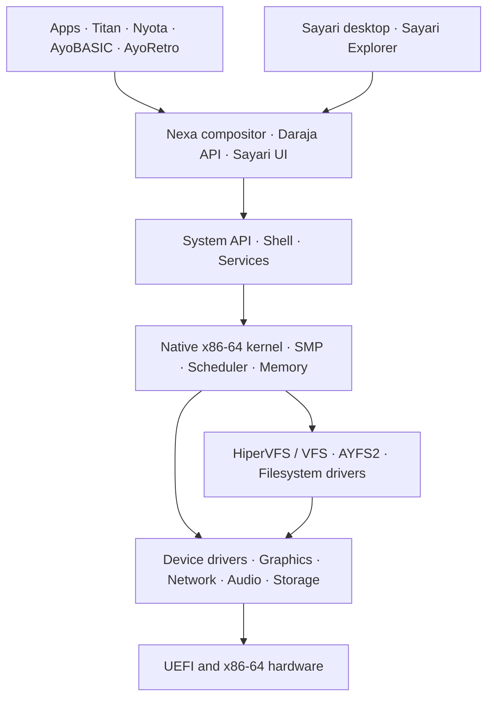

<div align="center">

# 🌌 AyoOS Project

### A new operating system. Its own kernel. Its own identity.

**An independent, 64-bit, bare-metal operating system built from the ground up.**


**[Introduction](#-what-is-ayoos) · [Architecture](#-architecture) · [Filesystems](#-the-filesystem-universe) · [Users & security](#-users-groups--security) · [AyoRetro](#-ayoretro) · [Roadmap](#-roadmap)**

</div>

---

> [!IMPORTANT]
> **AyoOS is under active development.** Its kernel, desktop and many subsystems are implemented and tested, but it is not a finished, security-certified consumer operating system. A filesystem marked **Ready** below is complete **within the explicitly documented development and testing scope**; it is not a guarantee of flawless operation with every possible variant, configuration or physical device.
>
> **This repository is the public showcase.** The core AyoOS source and its external ports are held in separate private repositories. This page is not a source release or a downloadable operating-system image.

## ✨ What is AyoOS?

**AyoOS is not a Linux distribution, a modified Windows installation or a repackaged existing kernel.** It is an independently developed, x86-64 operating system with its own UEFI boot process, kernel, scheduler, memory management, process model, storage subsystem, virtual filesystem, graphics stack, APIs and desktop environment.

AyoOS draws inspiration from the history of personal computing while aiming for a modern desktop architecture. A particularly ambitious goal is to understand storage formats associated with **Amiga, Atari, Commodore, BeOS, OS/2, NetWare, Solaris, Linux, Windows and Apple platforms** — alongside AyoOS's own native filesystems.

Its main code is written in **C**, with **Zig** in selected components. Third-party libraries and adapted ports are used where useful; developing a kernel independently does not mean reinventing every library or file format.

> **Build tomorrow. Remember yesterday.**

## ⚙️ Architecture



| Component | Capabilities | Development status |
|:--|:--|:--|
| **UEFI startup** | Custom boot path, framebuffer, bootable disk images | Implemented |
| **Native kernel** | x86-64, multicore/SMP, threads and processes, scheduler | Implemented; hardening ongoing |
| **Memory** | Physical/virtual memory, paging, process address spaces | Implemented; hardening ongoing |
| **Storage / VFS** | Multiple drivers, recognition, block I/O and storage identity | Implemented; expanding |
| **Sayari / Nexa** | Window compositor, desktop shell, hosted application surfaces | Implemented; evolving |
| **AyoNet** | TCP/IP, TCP/UDP, DNS, DHCP, ICMP, HTTP/HTTPS | Implemented; evolving |
| **Audio** | Intel HDA and userspace audio decoding | Implemented; streaming improvements planned |
| **Input / USB** | xHCI, HID and PS/2 paths | Implemented; hardware coverage varies |
| **GPU** | virtio/virgl and a purpose-built AMD RDNA compositing backend | In development |
| **User security** | Basic accounts and permission hooks, expanded security design | Partially implemented |
| **Automated testing** | Build, QEMU boot and filesystem regression workflows | Configured; individual runs may fail |

### Volume addressing

AyoOS uses **letter + number** notation. The **letter identifies a physical device**, while the **number identifies one of its volumes**.

```text
A1:   First volume on device A
A2:   Second volume on device A
B1:   First volume on device B
G2:   Second volume on device G
```

This combines the familiarity of drive letters with the clarity of device/partition separation. The addressing migration is completed within the project's tested scope.

---

## 💾 The filesystem universe

AyoOS's storage effort encompasses **native, Unix-like, Windows, Apple, server and retro** disk formats. The following matrix follows the project's implementation-status documentation as of **14 October 2026**.

**Legend:** ✅ **Ready** = completed for a documented tested profile; 🛠️ **In development** = incomplete implementation, tests, integration or recognition-only stage; 🧭 **Planned** = future concept, not an available working driver. **RO** = read-only; **RW** = read/write. These are internal project status classifications, **not vendor certifications**.

| Filesystem or variant | Original OS / associated platform | Status | Current scope or limitation |
|:--|:--|:--|:--|
| **Amiga FFS** | **AmigaOS** (Commodore Amiga) | ✅ Ready | RW; audited format support |
| **Amiga OFS** | **AmigaOS** (Commodore Amiga) | ✅ Ready | RW; audited format support |
| **APFS** | Apple **macOS / iOS** | 🛠️ In development | Preliminary metadata/root recognition; not a full file browser |
| **Atari DOS 2.0S / 2.5** | **Atari 8-bit** systems | 🛠️ In development | ATR/XFD handling, substantial RW; density/feature limits |
| **AYFS1** | **AyoOS** native (legacy) | ✅ Ready | Native legacy filesystem, RW |
| **AYFS2** | **AyoOS** native | ✅ Ready | Native CoW filesystem, RW, advanced metadata features |
| **AYFS3** | **AyoOS** design concept | 🧭 Planned | Design, not a finished driver |
| **bcachefs** | **Linux** | 🛠️ In development | Recognition work only; no general file RW |
| **BFS / Be File System** | **BeOS / Haiku** | ✅ Ready | RW within audited scope |
| **Btrfs** | **Linux** | ✅ Ready | RW in tested single-device, non-RAID, non-snapshot scope |
| **CBM DOS — D64** | **Commodore 64 / 1541** | 🛠️ In development | Retro disk-image RW tests |
| **CBM DOS — D71** | **Commodore 128 / 1571** | 🛠️ In development | Retro disk-image RW tests |
| **CBM DOS — D81** | **Commodore 128 / 1581** | 🛠️ In development | Retro disk-image RW tests |
| **EROFS + AyoOS RW** | **Linux** format + AyoOS write extension | ✅ Ready | Custom tested write support; upstream EROFS is read-only by design |
| **exFAT** | **Microsoft Windows**, removable media | ✅ Ready | RW |
| **ext2** | **Linux** | ✅ Ready | Native RW driver |
| **ext3** | **Linux** | ✅ Ready | RW through adapted lwext4 components |
| **ext4** | **Linux** | ✅ Ready | RW through adapted lwext4 components |
| **F2FS** | **Linux**, flash-friendly storage | ✅ Ready | Extensive tested RW; some format/feature limits |
| **FAT12** | **MS-DOS** and PC-compatible systems | ✅ Ready | RW |
| **FAT16** | **MS-DOS / Windows** | ✅ Ready | RW |
| **FAT32** | **Microsoft Windows** | ✅ Ready | RW |
| **GEMDOS** | **Atari ST / TOS** | ✅ Ready | RW |
| **HAMMER2** | **DragonFly BSD** | 🛠️ In development | Early VFS hooks; not complete file operations |
| **HFS+** | **Mac OS / macOS** | 🛠️ In development | Substantial RW work; journaling and integration gaps |
| **HFSX** | Apple **macOS** | 🛠️ In development | HFS+ family variant, work ongoing |
| **HPFS** | **IBM / Microsoft OS/2** | ✅ Ready | RW |
| **ISO 9660** | **CD-ROM standard**, cross-platform | ✅ Ready | RO, as intended for the format |
| **JFS (AIX fsv4)** | **IBM AIX** | 🛠️ In development | Host-tested RW; limited kernel integration |
| **JFS / JFS2 (Linux)** | **Linux**, IBM JFS lineage | 🛠️ In development | Host-tested RW; directory/inode limits |
| **MyDOS** | **Atari 8-bit** | 🛠️ In development | ATR/XFD, subdirectories, bounded RW |
| **NILFS2** | **Linux** | 🧭 Planned | Log-structured filesystem idea |
| **NTFS** | **Windows NT / Windows** | ✅ Ready | RW within audited scope |
| **NWFS286** | **Novell NetWare** | 🛠️ In development | Advanced compatibility tests; unfinished deployment |
| **NWFS386** | **Novell NetWare** | 🛠️ In development | Advanced RW and crash testing; journaling limitations |
| **ProDOS** | **Apple II** | 🧭 Planned | Future retro disk-format target |
| **Solaris UFS / UFS1** | **Sun Solaris / illumos** | ✅ Ready | RW, power-failure and error-injection validation |
| **SpartaDOS / SpartaDOS X** | **Atari 8-bit** | 🛠️ In development | Substantial **RO** support; RW not complete |
| **SquashFS 4.x** | **Linux / embedded** | ✅ Ready | **RO by design** |
| **tmpfs / ramfs** | **Unix-like / Linux** memory filesystems | 🧭 Planned | Memory-backed facilities proposal |
| **UDF** | **DVD / Blu-ray**, cross-platform | 🛠️ In development | Very early work; not a complete reader |
| **XFS** | **SGI IRIX / Linux** | 🛠️ In development | Significant RW progress; outstanding scope gaps |
| **ZFS / OpenZFS** | **Sun Solaris / OpenZFS** | ✅ Ready | Tested single-vdev, non-RAID RW scope |

**Beyond filesystems:** **LUKS2** is an encrypted block-container format, not a filesystem. **QCOW2, VHDX, VMDK and VDI** are virtual-disk image formats, not filesystems. They are **planned** storage-layer ideas and are intentionally excluded from the matrix of filesystem drivers.

### AYFS2 — native storage

**AYFS2** is AyoOS's native copy-on-write filesystem. Its design includes file versioning, snapshots, integrity checks, recovery/crash-consistency safeguards, file-family concepts and encryption features. Distinct advanced operations have different levels of validation; their existence must not be mistaken for a production-grade guarantee across every scenario.

### More than partition letters

Storage integration also covers partition and media traditions such as **GPT, MBR, Atari AHDI, Amiga RDB and Apple partition maps**. The intent is practical interoperability rather than a visual imitation of another operating system.

---

## 🖥️ Sayari, Nexa & the desktop

**Sayari** is the desktop environment. **Nexa** is the compositing/window layer, while **Daraja** provides application/window integration.

- Desktop icons, taskbar, menus, wallpapers and managed windows.
- **Sayari Explorer** for drive and file navigation.
- Application surfaces, text, UI widgets and window decorations.
- Incremental rendering and damage-tracking approaches.
- Developing graphics acceleration for 2D compositing and effects.

**Sayari is also being developed separately for Linux**, with a Wayland-oriented application-hosting architecture. That work is part of a **multi-platform desktop vision**; it does not mean the bare-metal AyoOS kernel runs on Linux, or that the desktop ports are feature-identical.

The AMD RDNA effort targets focused 2D functionality — copies, blits, blending, compositing and effects — **not** a complete replacement for AMDGPU, OpenGL or Vulkan.

---

## 👥 Users, groups & security

AyoOS has an agreed design for **four user privilege levels**. The table describes the **target permissions architecture**; implementation is ongoing and does **not** yet enforce every rule across the system.

| Level | Role | Intended authority |
|:--:|:--|:--|
| **0** | **Guest** | Restricted account, access only to permitted files and activities |
| **1** | **User** | Personal files and ordinary programs; **cannot create or administer groups** |
| **2** | **SuperUser** | Delegated management, including creating groups and adding eligible users to self-created groups |
| **3** | **Administrator** | Comprehensive system management, user/group lifecycle and authorization of sensitive operations |

### Group management with explicit boundaries

The approved design gives each group a known creator and management scope:

- A **SuperUser** may create groups and add eligible members to groups **they created**, without asking the Administrator for each addition.
- A SuperUser **cannot modify Administrator-created groups**.
- Removing members or deleting a group created by a SuperUser **requires Administrator approval**.
- **Guest (level 0) accounts cannot be members of groups**.
- **User (level 1) accounts cannot create or manage groups**.

These are **approved behavioral rules**, not a statement that every authorization check is already implemented.

### Privacy, LAW and approvals

The planned **LAW** file-access model separates the right to **administer a system** from everyday permission to **read someone else's personal files**. An Administrator should not automatically bypass private-file LAW rules during ordinary access. Deliberate policy changes and controlled exceptions must be accountable and auditable. This policy is **not an absolute cryptographic barrier** against a top-level administrator.

Other planned pillars include durable **UID/GID** identity, per-process credentials, inherited folder permissions, secure group ownership, approved privileged actions and protected security logging (**AUDIT**).

### Guest sessions, data and continuity

The longer-term model includes isolated anonymous guest sessions, per-user trash, controlled recovery of data from deleted accounts (**AMANA DATA**), safe identity migrations, and a requirement to retain **two active Administrators** in a fully configured multiuser setup (the **SITÓW** rule).

**Implementation reality:** login/account commands and some filesystem permissions already exist; credential hardening and account-database migrations are under way. **Unified VFS enforcement, independent process identity, multiuser session isolation, full approval workflows and protected audit trails remain incomplete**. AyoOS should not be treated as security-hardened for sensitive production data.

---

## 🕹️ AyoRetro — classic computers, native desktop integration

**AyoRetro** is a growing family of user-space emulator applications that integrate classic computing platforms into **Sayari**. The idea is to use real emulator cores with AyoOS-native windows, display buffers, media and input — not merely display screenshots of old machines.

| Project | Platform | Status | Progress |
|:--|:--|:--|:--|
| **AyoAtariRetro** | **Atari 8-bit / Atari 5200** | **Working prototype — in development** | Atari800/libatari800 core runs within AyoOS/QEMU; frames rendered in a hosted Sayari window; input/control refinement continues |
| **AyoAmigaRetro** | **Commodore Amiga** | **In development** | UAE/FS-UAE libamiga core port and Nexa window integration; broader emulation compatibility remains under evaluation |
| **AyoCommodoreRetro** | **Commodore 64 / 128 family** | **Planned** | Proposed future emulator and host integration |
| **AyoRetro host layer** | **Multi-platform** | **Design in progress** | Shared concepts for input, video, sound and media; interfaces must adapt to different emulator cores |

**A distinction that matters:** AyoOS may read an **Amiga FFS**, **Atari DOS**, **GEMDOS** or **Commodore D64** disk image without being able to run every program from that machine. **Filesystem compatibility is not the same as full software emulation.**

Third-party emulators have their own licenses (including GPL where applicable). Original ROMs, firmware and commercial software must be used only with appropriate rights. This public repository distributes none of them.

---

## 🌐 Networking, sound, languages & applications

| Name | Purpose |
|:--|:--|
| **AyoNet** | Native TCP/IP stack with DNS, DHCP, ping, TCP/UDP, HTTP and HTTPS paths |
| **Intel HDA audio** | Native PCM playback and userspace audio decoding |
| **Titan Browser** | In-house browser development with HTML/CSS, JavaScript and HTTPS components |
| **Nyota** | Custom interpreted language with graphics, application and UI capabilities |
| **AyoBASIC** | BASIC-style interpreter for education and lightweight scripting |
| **Daraja** | Application and hosted-window API |
| **Sayari Explorer** | Desktop file and drive management |
| **Jalada** | Archive management |
| **OFISI** | Developing family of office-style applications |

These are project components and development targets, not a promise that every site, media codec, API or third-party application is already supported.

## 🧪 Testing and engineering approach

The private development repository includes a toolchain and workflows for **clean builds**, **QEMU/OVMF boot smoke tests**, **boot logs/screenshots** and **filesystem regression suites**, including focused **AYFS2** testing. Selected filesystem formats are additionally checked using original or independent reference utilities and fault-injection scenarios.

**A CI configuration is not a green test result.** The outcome of each run depends on the specific commit and the tests actually completed. The public showcase cannot build the private operating system by itself.

## 🗺️ Roadmap

- Complete the redesigned **users, groups, LAW, privileged approvals and audit** architecture.
- Expand filesystem support, cross-checking and robustness for unfinished formats.
- Improve **Sayari**, **Nexa**, application hosting and multi-platform desktop work.
- Extend **AyoRetro** with improved Atari/Amiga integration and future retro platforms.
- Continue focused **AMD RDNA 2D graphics** and virtio/virgl work.
- Improve audio streaming, hardware-device compatibility and resilience.
- Strengthen automated boot, GUI, stress and storage regression tests.
- Explore longer-term self-hosting and native development tools.

## 🔒 Source availability & legal notes

**AyoOS-Project is a public information repository, not the main source repository.** AyoOS core sources and ported dependencies currently remain private. An openly visible README does **not** mean the core system or its third-party components have been released under an open-source license.

Names of historical systems and companies are used only to identify filesystem origins or emulator targets. This project is independent of those original vendors. Third-party code, emulator cores and ROMs remain subject to their respective licenses and rights.

No license file has been selected for this public showcase; publication does not grant unrestricted reuse rights.

## 🤝 Discussion & feedback

Interested in operating systems, obscure filesystems, retro computing or native desktop graphics? Technical discussion and constructive feedback are welcome via **[GitHub Issues](https://github.com/Klucznik26/AyoOS-Project/issues)**.

---

<div align="center">

### AyoOS — building tomorrow while remembering yesterday.

*Independent OS engineering · Filesystem interoperability · Desktop computing · Retro heritage*

**Project snapshot: 14 October 2026**

</div>
